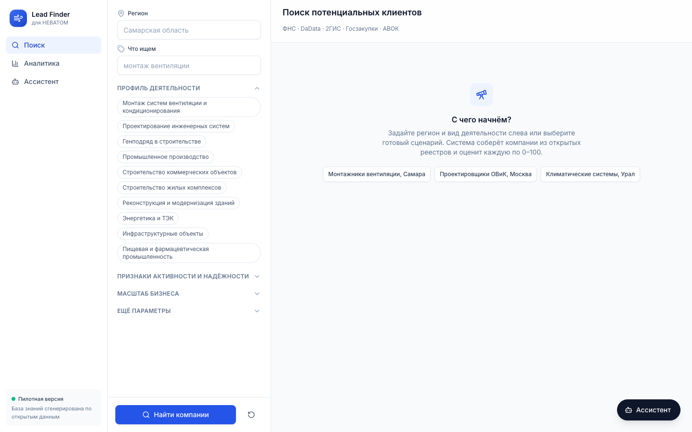
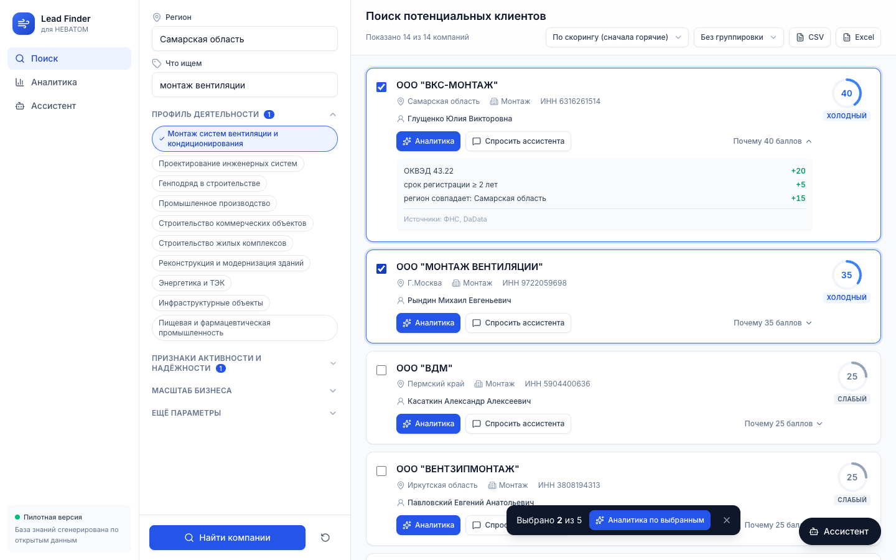
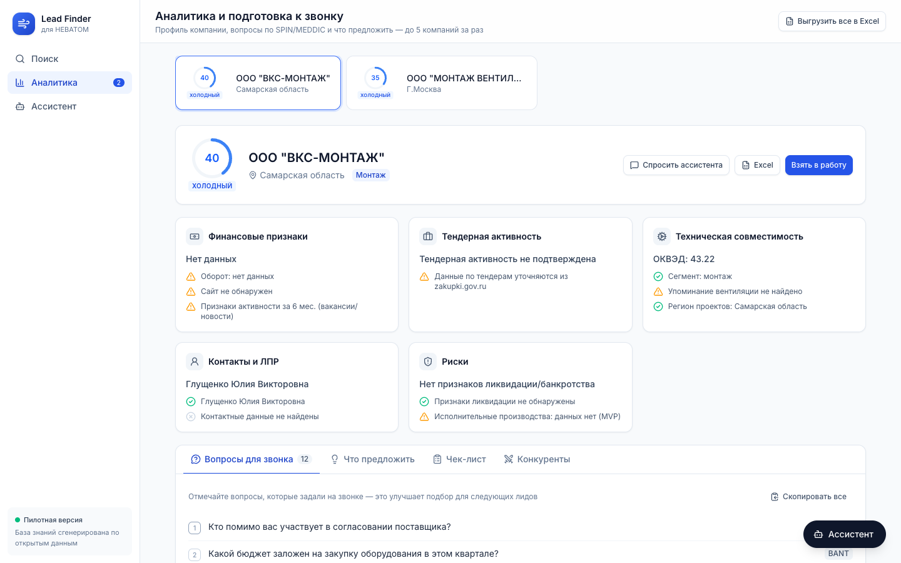
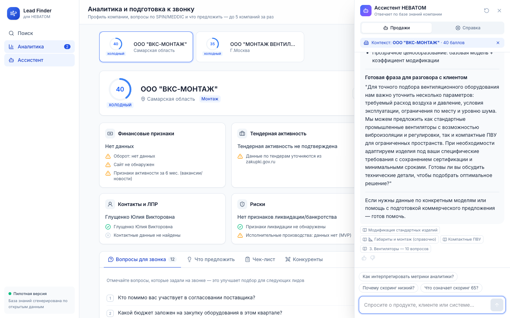

# Lead Finder — поиск и квалификация B2B-клиентов с ИИ


Пилот (MVP) для отдела продаж производителя вентиляционного оборудования. Система собирает компании
из открытых реестров, оценивает каждую по шкале 0–100, готовит отчёт и вопросы к звонку, а
ИИ-ассистент отвечает на вопросы по базе знаний компании.

> База знаний (`rag_docs/`) сгенерирована LLM по открытым источникам компании НЕВАТОМ
> и используется только для демонстрации.

## Что умеет

| Раздел | Что делает |
|---|---|
| **Поиск** | Ищет компании в ФНС (ЕГРЮЛ) и DaData по региону и виду деятельности, дозаполняет ОКВЭД и руководителя по ИНН, ставит оценку 0–100 и показывает, из чего она сложилась |
| **Аналитика** | По 1–5 выбранным компаниям: финансы, тендеры, совместимость по ОКВЭД, ЛПР, риски, что предложить, 12 вопросов к звонку (SPIN / MEDDIC / BANT), чек-лист |
| **Ассистент** | Чат по базе знаний (RAG) в двух режимах: «Продажи» (продукты, возражения, скрипты) и «Справка» (как пользоваться системой). Учитывает выбранную компанию, показывает источники ответа |
| **Экспорт** | CSV / Excel для CRM — и по поиску, и по аналитике |

Уровни оценки: **≥ 80** — горячий, **50–79** — тёплый, **30–49** — холодный, **< 30** — слабый.

## Скриншоты

**Стартовый экран** — фильтры и готовые сценарии поиска


**Результаты поиска** — оценка 0–100 и расшифровка баллов


**Аналитика** — профиль компании и вопросы для звонка


**Ассистент** — ответ по базе знаний с учётом выбранной компании


## Запуск (локально, одной командой)

Нужны: Python 3.12+, Node.js 20+, macOS или Linux.

```bash
cp .env.example .env    # один раз: впишите OPENAI_API_KEY и DADATA_API_KEY / DADATA_SECRET_KEY
./start.sh
```

Скрипт сам поставит зависимости при первом запуске, поднимет сервер и откроет интерфейс
на http://localhost:5173. Остановка — `Ctrl+C`.

Отдельно ставить базу данных не нужно: данные хранятся в файле `data/app.db` (SQLite),
база знаний — в `data/chroma`. Если `data/chroma` нет, `start.sh` проиндексирует `rag_docs/` сам.

## Источники данных

| Источник | Статус | Что даёт |
|---|---|---|
| ФНС ЕГРЮЛ (egrul.nalog.ru) | ✅ работает, ключ не нужен | Название, ИНН, ОГРН, регион, дата регистрации, руководитель |
| DaData | ✅ работает (бесплатный тариф) | Поиск по названию, ОКВЭД, статус, руководитель |
| 2ГИС | ⚠️ нужен действующий `DGIS_API_KEY` | Телефоны, сайты, адреса |
| Госзакупки (zakupki.gov.ru) | ⚠️ нужен сертификат Минцифры в системе | Участие в тендерах |
| АВОК | ⚠️ сайт не отдаёт результаты поиска | Отраслевой реестр |

Если реальные источники ничего не нашли, система показывает демонстрационные компании
с явной пометкой «Демо-данные».

## Тесты

```bash
.venv/bin/pytest                    # бэкенд: 24 теста
cd frontend && npm test             # интерфейс: юнит-тесты
cd frontend && npm run test:e2e     # сквозной сценарий в Chrome (при запущенном ./start.sh)
```

Сквозной тест — «робот-пользователь»: открывает приложение, ищет компании, запускает аналитику
и задаёт вопрос ассистенту, проверяя, что на каждом шаге всё отработало.

## Структура

```
main.py               точка входа FastAPI
handlers/             HTTP-эндпоинты: /search, /analytics, /chat, /rag
services/             бизнес-логика поиска, аналитики, чата, RAG
core/search/          коннекторы к источникам и скоринг
core/analytics/       сборка отчёта и вопросов к звонку
core/rag/             база знаний: разбиение, эмбеддинги, ChromaDB, поиск
core/chat/            режимы, подсказки, память сессии
rag_docs/             документы базы знаний (Markdown)
frontend/             интерфейс: React + TypeScript + Tailwind
  src/features/       страницы: search, analytics, chat
  e2e/                сквозной тест
start.sh              запуск всего одной командой
.claude/skills/lead-finder/  скилл для Claude Code: структура, запуск, изменения, проверки, публикация
```

Документация API (Swagger) после запуска: http://localhost:8000/docs

## Лицензия

MIT — см. [LICENSE](LICENSE).

## Контакты

**Автор:** Ivan P · Telegram: [@nonoyessure](https://t.me/nonoyessure)
